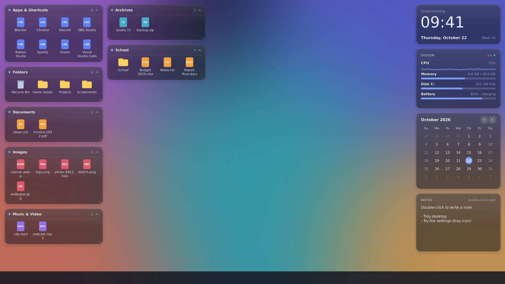
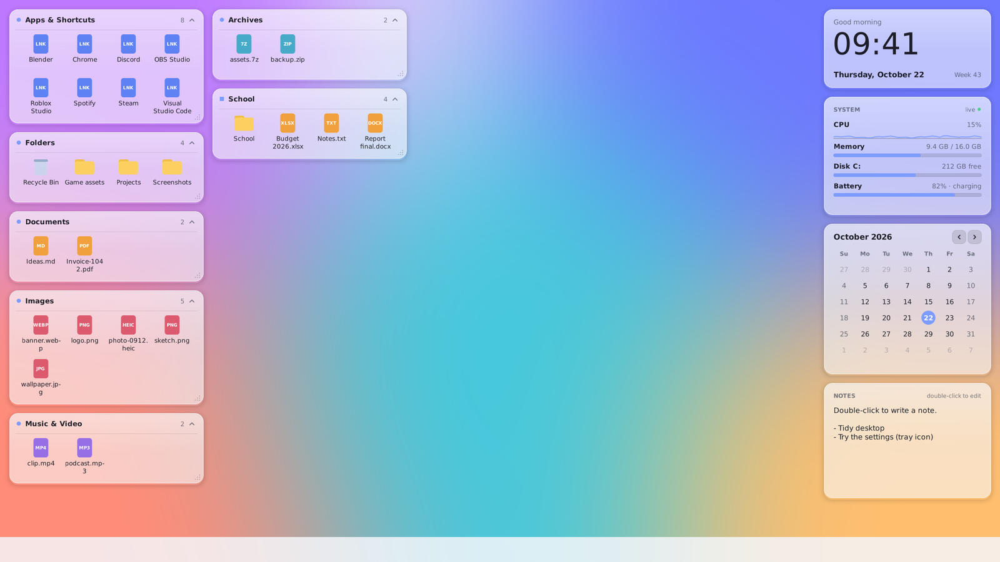
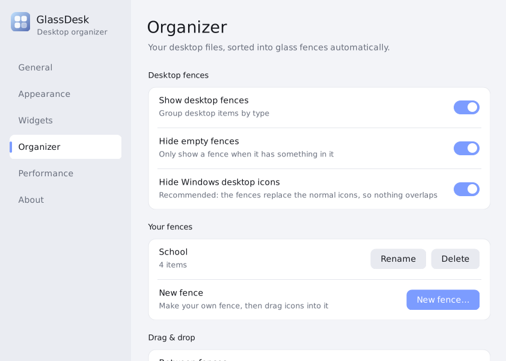
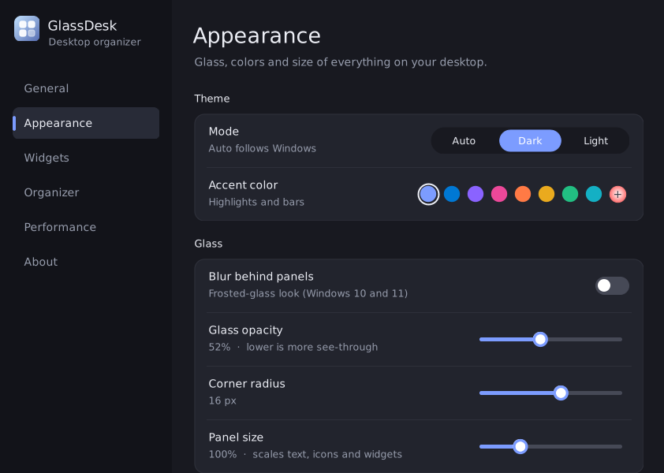
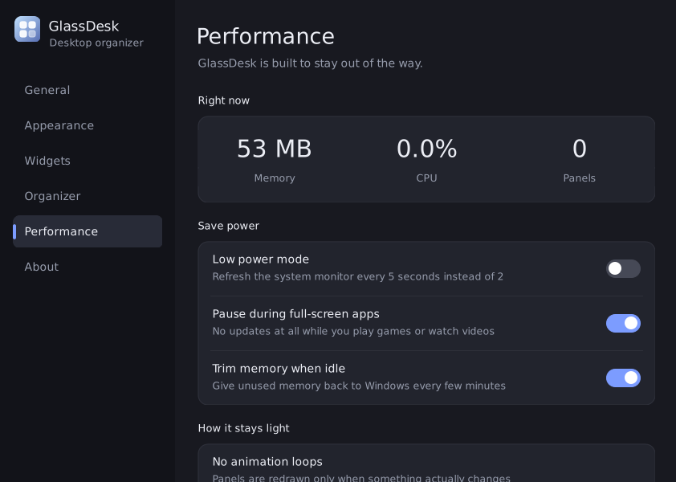

<p align="center">
  
</p>

<h1 align="center">GlassDesk</h1>

<p align="center">
  A lightweight, glass-style desktop organizer for Windows 10 and 11.<br>
  Auto-sorting fences, drag &amp; drop, and simple widgets in one small, native app.
</p>

<p align="center">
  
  
  
</p>



## What it does

GlassDesk sorts the icons on your desktop into frosted-glass **fences**, such as Apps, Folders, Documents and Images. It also adds a few widgets beside them. It sits behind your windows like part of the wallpaper, and it uses almost no CPU while nothing on the desktop is changing.

### Organizer
- **Auto-sorting fences:** desktop items go into *Apps & Shortcuts, Folders, Documents, Images, Music & Video, Archives* and *Other files*. New files appear in the right fence on their own.
- **Your own fences:** make fences like "School" or "Games" and drag icons into them.
- **Folder fences:** show any folder, such as Downloads, as its own fence.
- **Drag & drop:** drag icons between fences, onto a folder to move them inside, in from File Explorer, out to other apps, or onto the Recycle Bin.
- **Clean desktop:** the normal Windows desktop icons are hidden, so nothing overlaps. The Recycle Bin lives in a fence.
- Roll fences up and down, resize them, and scroll them. Panels snap to the screen edges and to each other.

### Widgets
- **Clock:** time, date, week number and a greeting.
- **System monitor:** live CPU (with a small graph), memory, disk and battery.
- **Calendar:** month view with today highlighted.
- **Notes:** a sticky note. Double-click it to write.

### Looks
- Blur behind the panels on Windows 10 and 11, with adjustable opacity, corner radius and size.
- Dark, light, or **Auto**, which follows your Windows setting.
- Choose an accent color.

### Light on your PC
- Panels are redrawn only when something changes. Nothing animates in the background.
- File changes are detected by Windows events, without polling.
- Updates pause while you play full-screen games or watch videos.
- Memory goes back to Windows when idle.
- A single ~160 KB `.exe` using the .NET Framework that already comes with Windows. No browser engine and nothing extra to install.

<p align="center">
  
  
</p>

## Download & install

1. Download **`GlassDesk-Setup.msi`** from the [Releases](../../releases) page.
2. Double-click it. It installs just for your user account, with no admin password needed, into `%LocalAppData%\Programs\GlassDesk`.
3. GlassDesk starts right away and then **every time you sign in**. It is also in the Start menu.

> **"Windows protected your PC"?** The installer is not code-signed, so SmartScreen may warn you. Click **More info → Run anyway**, or build it yourself (see below).

**Uninstall:** Settings → Apps → Installed apps → GlassDesk → Uninstall. This closes the app, removes the startup entry and brings your normal desktop icons back.

## How to use it

| Action | What happens |
|---|---|
| <kbd>Ctrl</kbd> + <kbd>Alt</kbd> + <kbd>G</kbd> | Show or hide all panels |
| Click the tray icon | Open Settings |
| Drag a fence's title bar | Move it. Drag the bottom-right corner to resize |
| Double-click a fence title | Roll the fence up or down |
| Double-click an icon | Open it (single-click is an option) |
| Right-click an icon | Open, show in File Explorer, copy path, **Move to fence**, delete, properties |
| Right-click a fence title | Rename, new fence, hide, delete |

### Drag & drop

| Drag… | Result |
|---|---|
| Icon → another fence | It stays in that fence. The file is **not** moved. Right-click → *Back to …* undoes it |
| Icon → a folder icon | Moves the file into that folder. Hold <kbd>Ctrl</kbd> to copy. <kbd>Ctrl</kbd>+<kbd>Z</kbd> in File Explorer undoes it |
| File Explorer → a fence | Moves the file onto your desktop, into that fence (<kbd>Ctrl</kbd> to copy) |
| Icon → File Explorer / an app | Works like dragging any file, for example into an email |
| Icon → Recycle Bin | Asks first, then moves it to the Recycle Bin |

## Settings

Settings has six pages: **General** (start with Windows, hotkey, lock positions), **Appearance**, **Widgets**, **Organizer** (categories, your fences, folder fences), **Performance** (GlassDesk's own live memory and CPU use) and **About**.

<p align="center">
  
  
</p>

Your settings are saved in `%AppData%\GlassDesk\settings.ini`. Delete that file to start fresh.

## Build from source

The `.exe` and `.msi` are not stored in the repository. Build them yourself, or download them from Releases.

### On Windows (no installs needed)

```bat
build.bat
```

This uses the C# compiler that ships with Windows (`csc.exe` from .NET Framework 4.x) and writes `build\GlassDesk.exe`.

### On Linux (exe + MSI)

```sh
sudo apt install mono-devel wixl
./build.sh        # build/GlassDesk.exe
./build.sh msi    # also build/GlassDesk-Setup.msi
```

`build.sh` compiles against the real .NET Framework 4.5 reference assemblies, so the app only uses APIs that exist on Windows.

### Project layout

```
src/
  Program.cs       entry point, single instance, crash logging
  App.cs           tray icon, timers, layout, fence management
  Fences.cs        the organizer: fences, sorting, drag & drop
  Widgets.cs       clock, system monitor, calendar, notes
  GlassWindow.cs   base class for glass panels (layered windows)
  SettingsForm.cs  the settings window
  Controls.cs      toggle, slider and other small UI controls
  Settings.cs      settings file and theme colors
  Native.cs        Windows API calls (blur, icons, file operations, memory)
assets/            app icon and runtime config
installer/         GlassDesk.wxs, the MSI definition (WiX format, built with wixl)
docs/screenshots/  images used in this README
```

## Troubleshooting

- **It closes or something breaks:** GlassDesk shows a message with the reason and writes details to `%AppData%\GlassDesk\error.log`. Please attach that file when you open an issue.
- **Want the normal desktop icons back:** Settings → Organizer → turn off *Hide Windows desktop icons*. Exiting GlassDesk from the tray also brings them back.
- **Panels are off-screen after changing monitors:** Settings → Widgets → *Reset widget positions*, and Settings → Organizer → *Reset fence layout*.

## Requirements

- Windows 10 or Windows 11
- .NET Framework 4.5 or newer, which is already included in Windows 10 and 11

## Changelog

See [CHANGELOG.md](CHANGELOG.md).
