<picture>
  <source media="(prefers-color-scheme: light)" srcset="docs/banner-light.svg">
  
</picture>

<p align="center">
  <a href="../../releases/tag/v1.8.6"></a>
  <a href="../../releases/tag/v1.7.2_Linux"></a>
  <a href="../../releases"></a>
</p>

<p align="center">
  
  
  
  
  
  <a href="../../stargazers"></a>
  
</p>

<p align="center">
  <a href="#windows"><b>Windows</b></a> &nbsp;·&nbsp;
  <a href="#linux"><b>Linux</b></a> &nbsp;·&nbsp;
  <a href="#android"><b>Android</b></a> &nbsp;·&nbsp;
  <a href="#help"><b>Info &amp; help</b></a>
</p>

<picture>
  <source media="(prefers-color-scheme: light)" srcset="docs/screenshots/hero-light.jpg">
  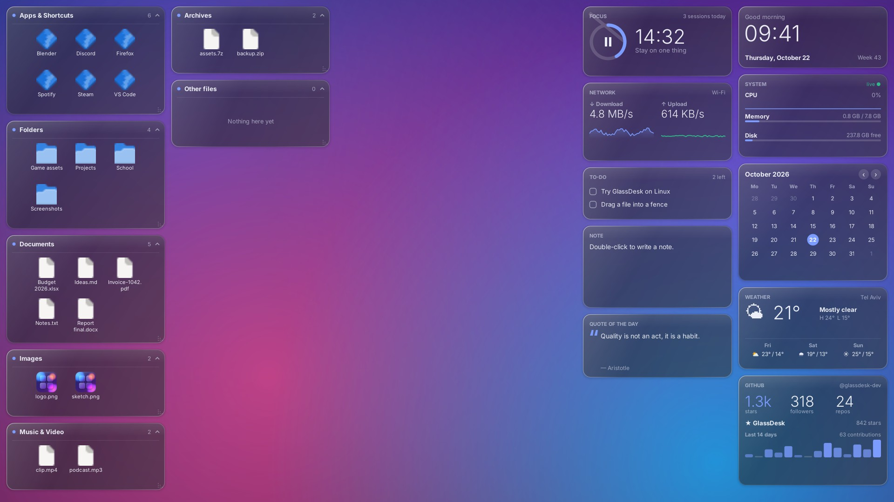
</picture>

<table>
  <tr>
    <td width="33%" valign="top"><h3>🗂️ Fences that sort themselves</h3>Apps, folders, documents and images land in their own frosted-glass fence, automatically.</td>
    <td width="33%" valign="top"><h3>🧊 Real frosted glass</h3>Your wallpaper glows softly through every panel, with a light-catching rim.</td>
    <td width="33%" valign="top"><h3>🧩 12 widgets</h3>Clock, weather, calendar, to-do, notes, focus timer, GitHub stats and more.</td>
  </tr>
  <tr>
    <td valign="top"><h3>⚡ Feather-light</h3>One ~250 KB app. Almost no CPU while nothing changes, and it pauses during games.</td>
    <td valign="top"><h3>🎨 Make it yours</h3>Dark, light or auto, accent colors, themes and a wallpaper changer.</td>
    <td valign="top"><h3>📱 On your phone too</h3>The same glass look as Android home-screen widgets, with app fences.</td>
  </tr>
</table>

<a id="windows"></a>

## 🪟 GlassDesk for Windows

GlassDesk sorts the icons on your desktop into frosted-glass **fences**, such as Apps, Folders, Documents and Images. It also adds a few widgets beside them. It sits behind your windows like part of the wallpaper, and it uses almost no CPU while nothing on the desktop is changing.

<p align="center">
  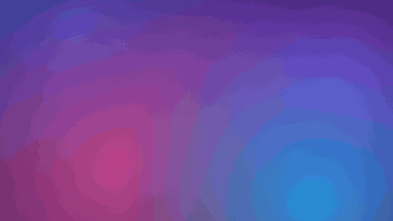
</p>

### ✨ New in 1.8
- **26 themes**, including a new **Windows themes** set: *Mica material, Acrylic material, Mica Alt, Windows Light, Windows Dark, Bloom, Glow, Sunrise, Flow* and *Captured Motion*.
- **Stack anything:** drag a widget onto a widget, or a fence onto a fence, and GlassDesk offers to stack them. Each stack gets **tabs**, switches with a smooth slide, and keeps one size.
- **File stacks:** 4 or more files of the same type in a fence fold into one stack. Click to open it.
- **New search launcher** (<kbd>Ctrl</kbd> + <kbd>Alt</kbd> + <kbd>F</kbd>): your desktop as a grid of icons on blurred glass, with a **calculator**, **theme switching**, quick **commands** and **web search**.
- **Music widget:** the song playing in any app, with its cover and play / pause / next buttons, or the last song you heard.
- **Today widget:** rings for how much of the day, week, month and year has passed.
- **Organize desktop:** preview where every file goes and tick the ones to sort.
- **Layouts per monitor setup:** dock or undock a laptop and everything goes back to its spot for those monitors.
- **Match my wallpaper:** the accent color can come from your wallpaper.
- **Resize** widgets and fences from any edge, a **welcome screen** on first start, and menus and Settings drawn in your theme.

<p align="center">
  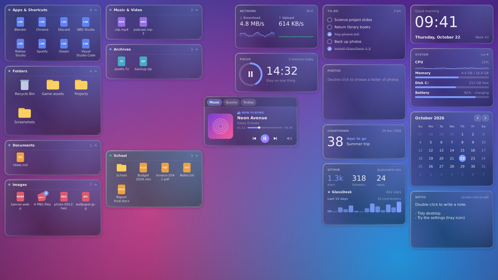
</p>

<table>
  <tr>
    <td width="50%" valign="top">
      <b>🗂️ Stacks with tabs</b><br>
      <sub>Drag a fence onto a fence, or a widget onto a widget. Click a tab to switch.</sub><br><br>
      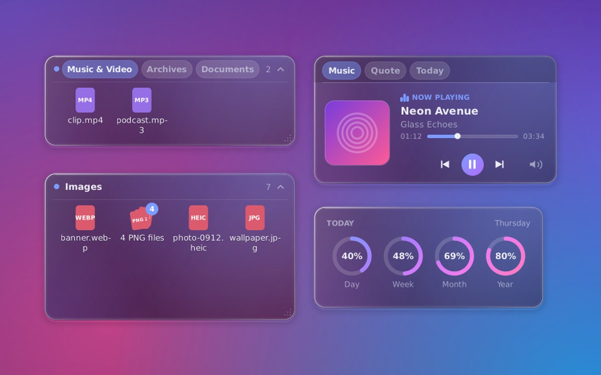
    </td>
    <td width="50%" valign="top">
      <b>🔍 Search launcher</b><br>
      <sub>Press Ctrl + Alt + F: your whole desktop as a grid of icons.</sub><br><br>
      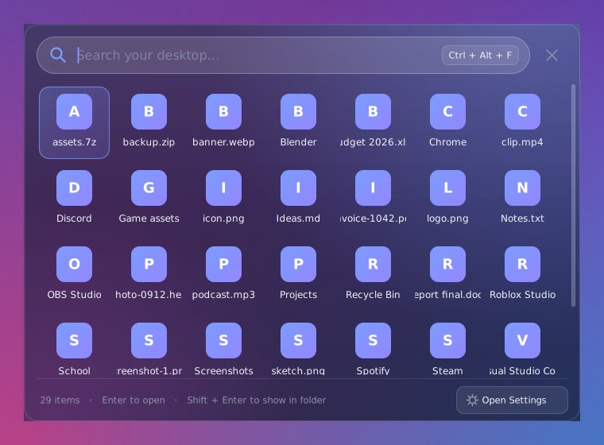
    </td>
  </tr>
  <tr>
    <td width="50%" valign="top">
      <b>🧮 Built-in calculator</b><br>
      <sub>Type a sum in the search box, press Enter to copy the answer.</sub><br><br>
      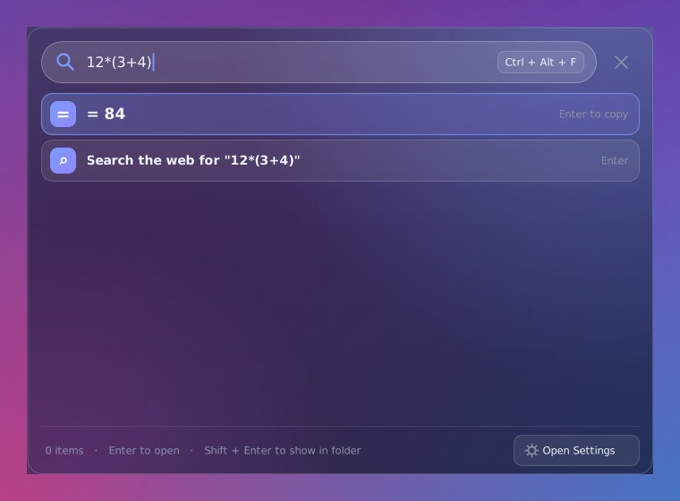
    </td>
    <td width="50%" valign="top">
      <b>🎨 Switch themes from search</b><br>
      <sub>Type a theme name like "ocean" or "mica".</sub><br><br>
      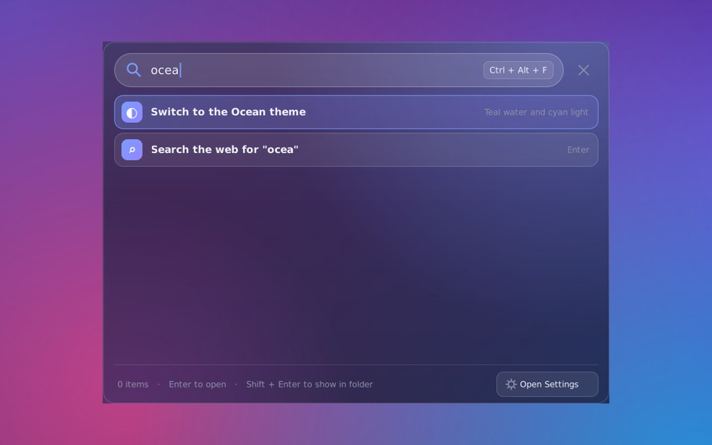
    </td>
  </tr>
  <tr>
    <td width="50%" valign="top">
      <b>🧹 Organize desktop</b><br>
      <sub>See where every file goes and tick the ones to sort.</sub><br><br>
      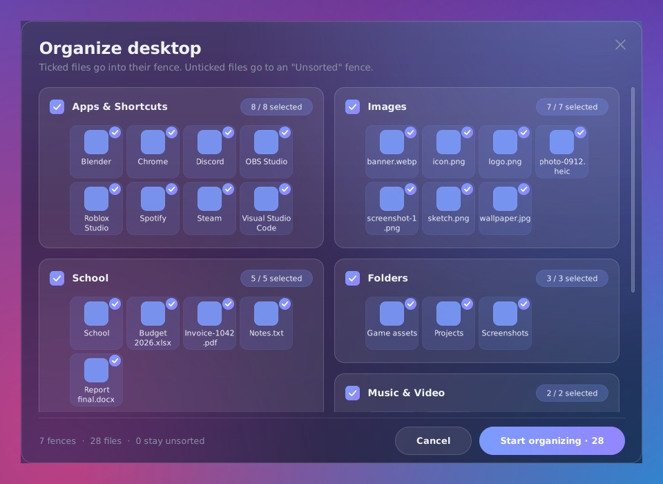
    </td>
    <td width="50%" valign="top">
      <b>👋 Welcome screen</b><br>
      <sub>Shown once, the first time GlassDesk starts.</sub><br><br>
      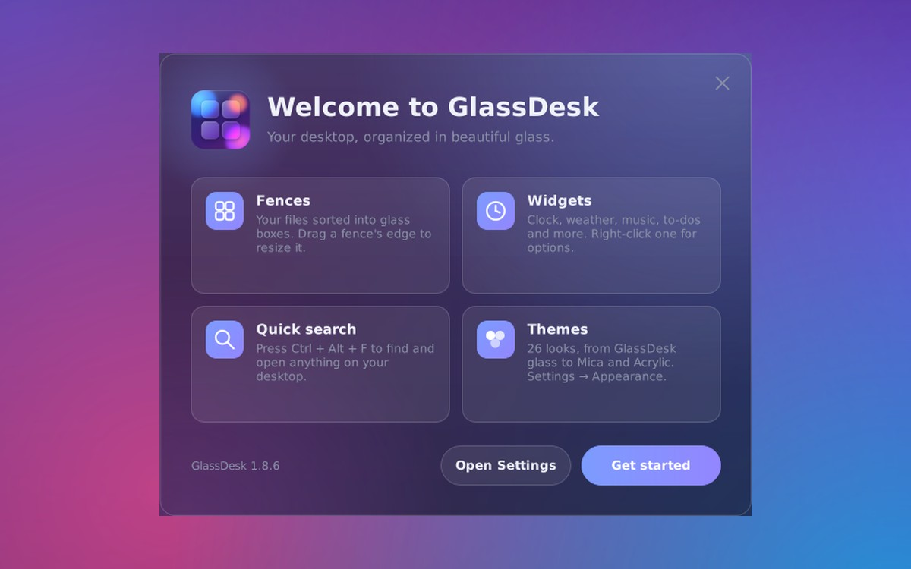
    </td>
  </tr>
</table>

### Organizer
- **Auto-sorting fences:** desktop items go into *Apps & Shortcuts, Folders, Documents, Images, Music & Video, Archives* and *Other files*. New files appear in the right fence on their own.
- **Your own fences:** make fences like "School" or "Games" and drag icons into them.
- **Folder fences:** show any folder, such as Downloads, as its own fence.
- **Rules:** send files to a fence by name, for example `*.pdf` → School or `Screenshot*` → Images.
- **Sort** each fence by name, type, date modified or size.
- **Fence colors, icon sizes and auto roll-up** from each fence's right-click menu.
- **Backup & sync:** export your layout to a `.glassdesk` file and import it anywhere.
- **Themes and a wallpaper changer** in Settings → Appearance.
- **Quick search:** press <kbd>Ctrl</kbd> + <kbd>Alt</kbd> + <kbd>F</kbd>, type a few letters, press Enter to open. Type a sum like `12*(3+4)` for the answer, a theme name to switch to it, or press <kbd>Ctrl</kbd> + <kbd>Enter</kbd> to search the web.
- **File stacks:** 4+ files of one type become a stack inside their fence.
- **Fence stacks:** drag a fence onto another to stack them, with a tab for each.
- **Organize desktop:** from the tray menu, see where every file goes and untick the ones to keep in an "Unsorted" fence.
- **Drag & drop:** drag icons between fences, onto a folder to move them inside, in from File Explorer, out to other apps, or onto the Recycle Bin.
- **Clean desktop:** the normal Windows desktop icons are hidden, so nothing overlaps. The Recycle Bin lives in a fence.
- Roll fences up and down, resize them, and scroll them. Panels snap to the screen edges and to each other.

### Widgets
- **Clock:** time, date, week number and a greeting.
- **System monitor:** live CPU (with a small graph), memory, disk and battery.
- **Calendar:** month view with today highlighted.
- **Notes:** a sticky note. Double-click it to write.
- **To-do:** a checklist you tick off right on the desktop.
- **Weather:** today and the next 3 days for your city, from [Open-Meteo](https://open-meteo.com) (free, no account).
- **Photo frame:** pictures from a folder you choose, one at a time.
- **Countdown** to a date and **Quote of the day**.
- **GitHub stats:** your stars, followers, repos, most-starred project and a 14-day activity chart. Double-click and type your username (public data, no sign-in).
- **Network meter:** live download and upload speed with small graphs.
- **Focus timer:** Pomodoro (25 min focus, 5 min break) with a progress ring and a notification when time is up.
- **Music:** what's playing in Spotify, YouTube or any player, with its cover, progress and controls. Shows your last song when nothing plays.
- **Today:** four rings for the day, week, month and year.
- **Widget stacks:** drag a widget onto another to stack them. Click a tab to switch.

### Looks
- **26 themes:** GlassDesk, Clean, Midnight, Ocean, Sunset, Forest, Rose, Aurora, Frost, Ember, Lavender, Mint, Neon, Graphite, Paper and Classic, plus 10 **Windows themes** (Mica material, Acrylic material, Mica Alt, Windows Light, Windows Dark, Bloom, Glow, Sunrise, Flow, Captured Motion). Each one has its own glass colors in dark and light, and some add a soft glow, a neon edge, or solid flat panels. Pick one in **Settings → Appearance**, then fine-tune it.

<p align="center">
  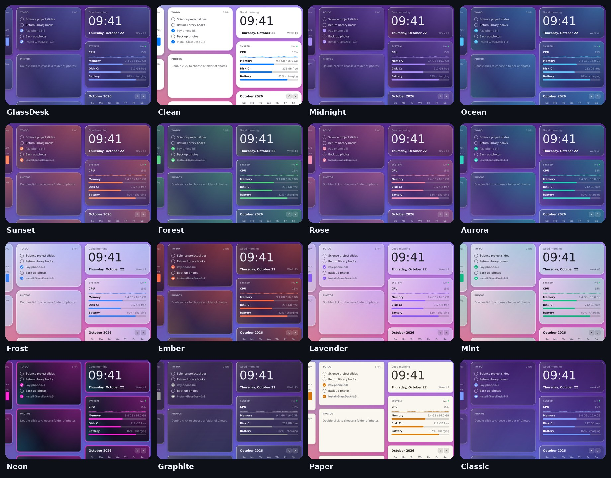
</p>

- **Real frosted glass:** your wallpaper shows softly blurred through every panel (GlassDesk makes the blur itself, so it works on every Windows 10 and 11 PC), with a light-catching rim, sheen and fine grain.
- Three glass styles (Frosted, Light blur, Clear) plus adjustable tint, corner radius and size.
- **Resize any widget or fence** by dragging its right edge, bottom edge or corner; widget text, numbers and charts grow with it.
- **Match my wallpaper:** take the accent color from your wallpaper.
- **Per-monitor layouts:** a saved layout for each monitor setup.
- Dark, light, or **Auto**, which follows your Windows setting.
- Choose an accent color.

### Light on your PC
- Panels are redrawn only when something changes. Nothing animates in the background.
- File changes are detected by Windows events, without polling.
- Updates pause while you play full-screen games or watch videos.
- Memory goes back to Windows when idle.
- A single ~250 KB `.exe` using the .NET Framework that already comes with Windows. No browser engine and nothing extra to install.

<p align="center">
  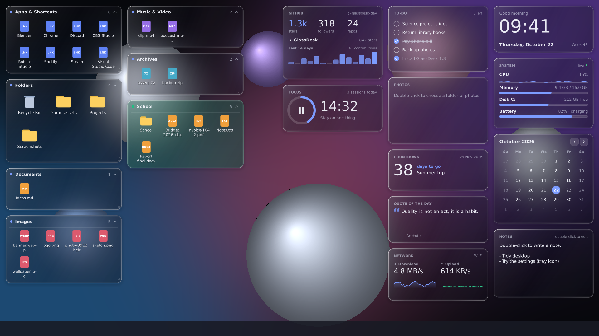
  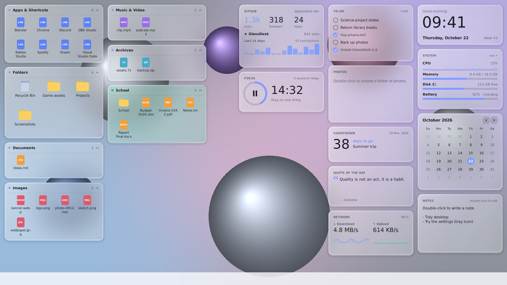
</p>

### Download & install
1. Download **`GlassDesk-Setup-1.8.6.msi`** from the [Releases](../../releases) page.
2. Double-click it. It installs just for your user account, with no admin password needed, into `%LocalAppData%\Programs\GlassDesk`.
3. GlassDesk starts right away and then **every time you sign in**. It is also in the Start menu.

> **"Windows protected your PC"?** The installer is not code-signed, so SmartScreen may warn you. Click **More info → Run anyway**, or build it yourself (see below).

**Uninstall:** Settings → Apps → Installed apps → GlassDesk → Uninstall. This closes the app, removes the startup entry and brings your normal desktop icons back.

<p align="center"></p>

<a id="linux"></a>

## 🐧 GlassDesk for Linux (beta)

> **Beta:** the Linux version is new. It works, but it hasn't been tested on every distro and desktop yet. Please [open an issue](../../issues) if something looks wrong, and attach `~/.config/glassdesk/error.log`.

GlassDesk also runs on **Ubuntu, Linux Mint, Debian, Fedora, Arch, openSUSE** and more, on GNOME, KDE Plasma, Cinnamon, XFCE and MATE. It has the same fences, widgets, glass blur and settings, rebuilt with Python and GTK.

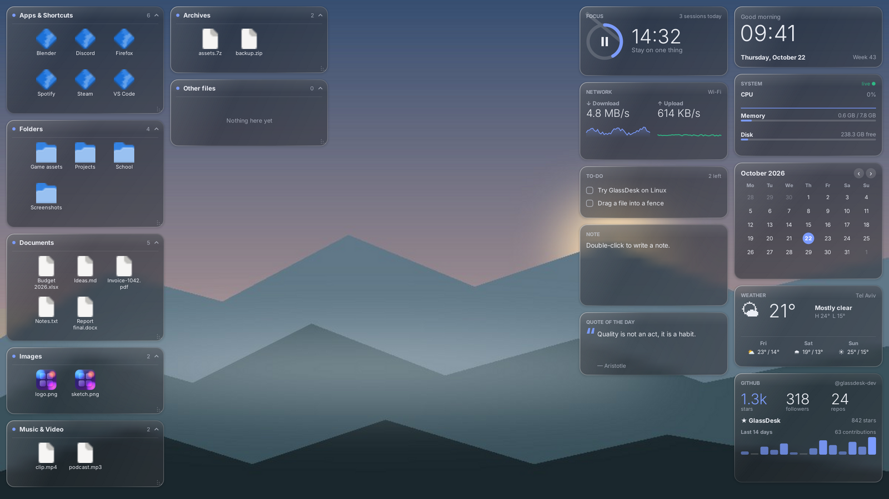

| Your Linux | Download from [Releases](../../releases) | How |
|---|---|---|
| Ubuntu, Mint, Debian, Pop!_OS, Zorin | `glassdesk_<version>_all.deb` | Double-click it, or `sudo apt install ./glassdesk_*_all.deb` |
| Any distro (one file) | `GlassDesk-<version>-x86_64.AppImage` | Allow executing, then double-click |
| Fedora, Arch, openSUSE, others | `GlassDesk-<version>-linux.tar.gz` | Unzip, then run `./install.sh` |

More details: [linux/README.md](linux/README.md).

<p align="center"></p>

<a id="android"></a>

## 🤖 GlassDesk for Android

GlassDesk is on your phone too, as **home-screen widgets**: clock, weather, calendar, to-do, notes, system, countdown, quote and three **fences** that hold up to 8 apps each.

<p align="center">
  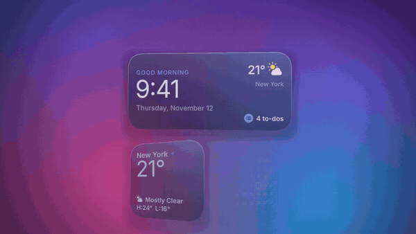
</p>

<p align="center">
  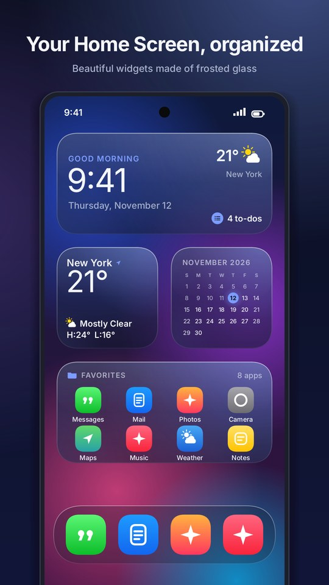
  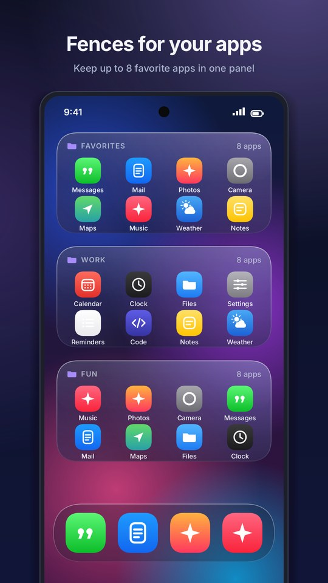
  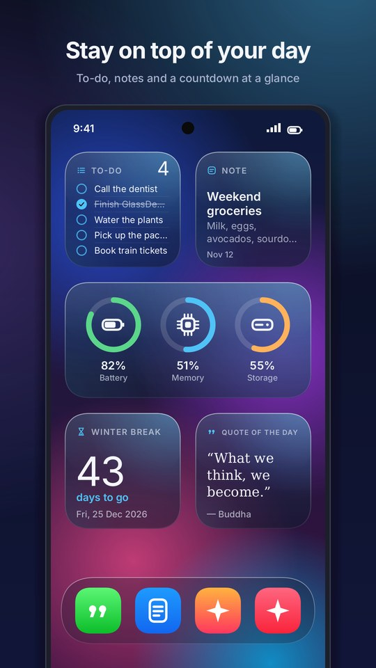
  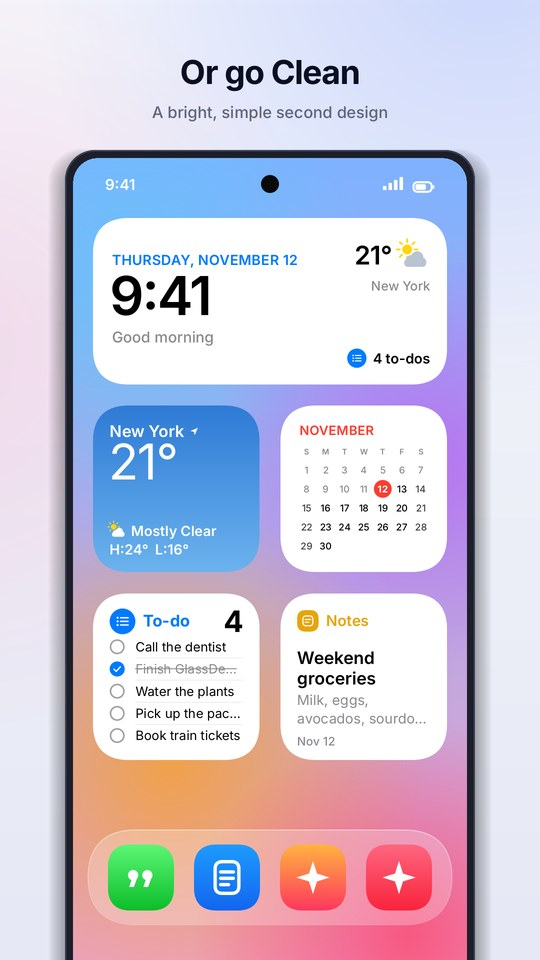
</p>

- **Two designs:** *GlassDesk* (frosted glass with a soft glow, the default) and *Clean* (bright and simple), each in light and dark, with your choice of accent color.
- **Tap to act:** tick off to-dos, open apps from a fence, refresh the weather, or get a new quote, right on the home screen.
- **Resizable** widgets that redraw to fit, and a settings app that follows the design you pick.
- **No account, ads or tracking.** Weather comes from [Open-Meteo](https://open-meteo.com).

**Install:** download **`GlassDesk-Android-1.7.2.apk`** from [Releases](../../releases) on your phone, open it and tap Install (Android 8.0 or newer). Then open GlassDesk and tap **Add** under a widget.

▶ [Watch the full launch video](../../releases/download/android-v1.7.2/GlassDesk-1.7.2-Android-Film.mp4)

More details: [android/README.md](android/README.md).

<p align="center"></p>

<a id="help"></a>

## 💬 Info & help

### How to use it
| Action | What happens |
|---|---|
| <kbd>Ctrl</kbd> + <kbd>Alt</kbd> + <kbd>G</kbd> | Show or hide all panels |
| <kbd>Ctrl</kbd> + <kbd>Alt</kbd> + <kbd>F</kbd> | Find anything on your desktop |
| Click the tray icon | Open Settings |
| Drag a fence's title bar | Move it. Drag the bottom-right corner to resize |
| Double-click a fence title | Roll the fence up or down |
| Double-click an icon | Open it (single-click is an option) |
| Right-click an icon | Open, show in File Explorer, copy path, **Move to fence**, delete, properties |
| Right-click a fence title | Rename, sort by, add a rule, stack with, new fence, hide, delete |
| Drag a widget onto a widget (or a fence onto a fence) | Offers to stack them. Click a tab to switch |
| Click a file stack | Open or close it |
| Tray icon → Organize desktop… | Preview and choose how your desktop gets sorted |

#### Drag & drop

| Drag… | Result |
|---|---|
| Icon → another fence | It stays in that fence. The file is **not** moved. Right-click → *Back to …* undoes it |
| Icon → a folder icon | Moves the file into that folder. Hold <kbd>Ctrl</kbd> to copy. <kbd>Ctrl</kbd>+<kbd>Z</kbd> in File Explorer undoes it |
| File Explorer → a fence | Moves the file onto your desktop, into that fence (<kbd>Ctrl</kbd> to copy) |
| Icon → File Explorer / an app | Works like dragging any file, for example into an email |
| Icon → Recycle Bin | Asks first, then moves it to the Recycle Bin |

### Settings
Settings has six pages: **General** (start with Windows, hotkey, lock positions), **Appearance**, **Widgets**, **Organizer** (categories, your fences, folder fences), **Performance** (GlassDesk's own live memory and CPU use) and **About**.

<p align="center">
  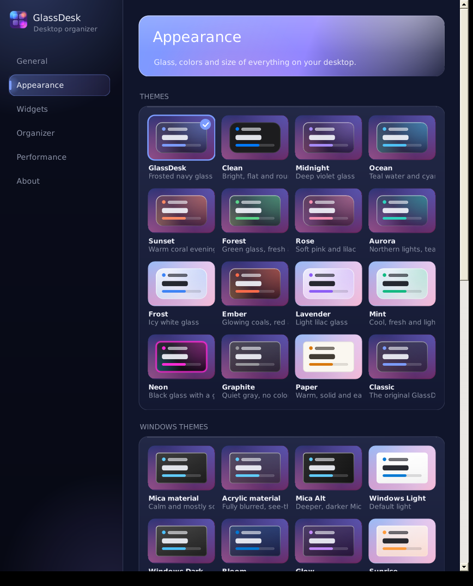
  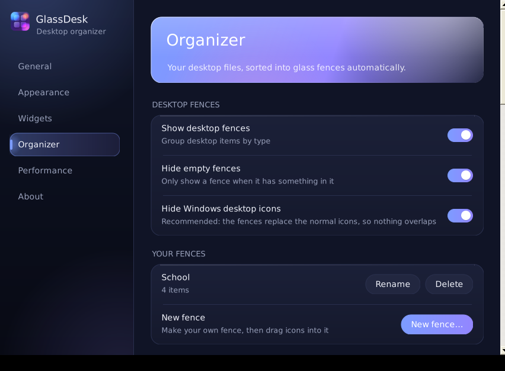
  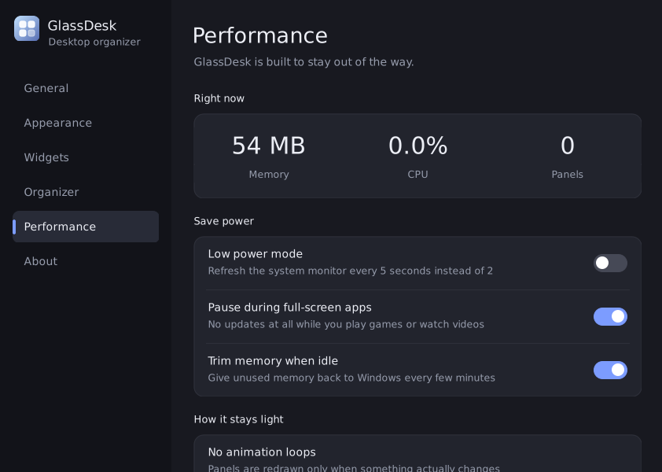
</p>

Your settings are saved in `%AppData%\GlassDesk\settings.ini`. Delete that file to start fresh.

### Updates
GlassDesk checks this repository's [Releases](../../releases) once a day. When a newer version is there, it shows a notification. One click downloads the `.msi` from GitHub and installs it; your fences, widgets and settings are kept. You can also click **Check now** in Settings → About.

**Publishing a new version** (for maintainers):

1. Raise the version in `src/Program.cs` (`AssemblyVersion`) and in `installer/GlassDesk.wxs` (`Version` and the two `UpgradeVersion` lines).
2. Build the `.msi` (`./build.sh msi`).
3. On GitHub, create a release with a tag like `v1.7.2` and attach `GlassDesk-Setup.msi`. The release notes are shown to people in the update window.

The updater only downloads installers from `github.com` over HTTPS, and only runs files that are real Windows Installer packages.

### Troubleshooting
- **It closes or something breaks:** GlassDesk shows a message with the reason and writes details to `%AppData%\GlassDesk\error.log`. Please attach that file when you open an issue.
- **Want the normal desktop icons back:** Settings → Organizer → turn off *Hide Windows desktop icons*. Exiting GlassDesk from the tray also brings them back.
- **Panels are off-screen after changing monitors:** Settings → Widgets → *Reset widget positions*, and Settings → Organizer → *Reset fence layout*.

### Requirements
- Windows 10 or Windows 11, or Linux with Python 3 and GTK 3 (preinstalled on most desktops), or Android 8.0 or newer
- .NET Framework 4.5 or newer, which is already included in Windows 10 and 11

<details>
<summary><b>Build from source</b></summary>

The `.exe` and `.msi` are not stored in the repository. Build them yourself, or download them from Releases.

#### On Windows (no installs needed)

```bat
build.bat
```

This uses the C# compiler that ships with Windows (`csc.exe` from .NET Framework 4.x) and writes `build\GlassDesk.exe`.

#### Windows app, built on Linux (exe + MSI)

```sh
sudo apt install mono-devel wixl
./build.sh        # build/GlassDesk.exe
./build.sh msi    # also build/GlassDesk-Setup.msi
```

`build.sh` compiles against the real .NET Framework 4.5 reference assemblies, so the app only uses APIs that exist on Windows.

#### Project layout

```
src/
  Program.cs       entry point, single instance, crash logging
  App.cs           tray icon, timers, layout, fence management
  Fences.cs        the organizer: fences, sorting, drag & drop
  Widgets.cs       clock, system monitor, calendar, notes
  Widgets2.cs      weather, to-do list, photo frame, countdown, quote
  Widgets3.cs      GitHub stats, network meter, focus timer
  Search.cs        quick search (Ctrl + Alt + F) and the "add rule" dialog
  Updater.cs       GitHub Releases updater, small web and JSON helpers
  Extras.cs        wallpaper changer, backup & restore, themes
  Backdrop.cs      the glass blur: a blurred copy of your wallpaper drawn behind panels
  GlassWindow.cs   base class for glass panels (layered windows)
  SettingsForm.cs  the settings window
  Controls.cs      toggle, slider and other small UI controls
  Settings.cs      settings file and theme colors
  Native.cs        Windows API calls (blur, icons, file operations, memory)
assets/            app icon and runtime config
installer/         GlassDesk.wxs, the MSI definition (WiX format, built with wixl)
docs/screenshots/  images used in this README
linux/             GlassDesk for Linux (Python + GTK) and its packaging (build-linux.sh)
android/           GlassDesk for Android: home-screen widgets and their settings app (Java, build.sh)
```

Android: see [android/README.md](android/README.md).

</details>

### Changelog

See [CHANGELOG.md](CHANGELOG.md).
