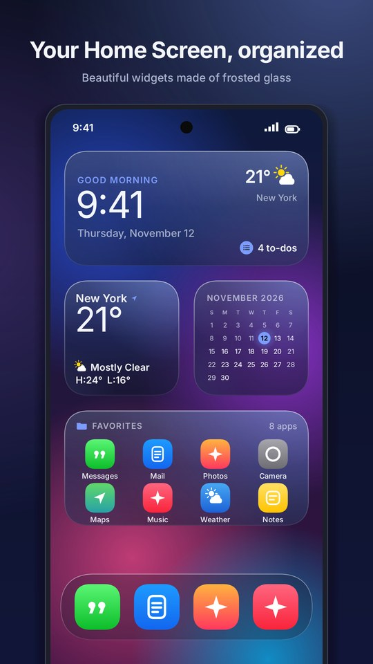
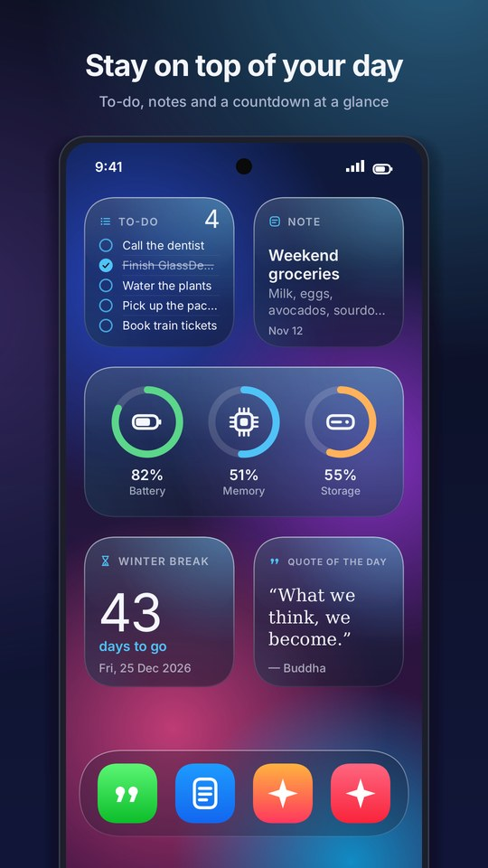
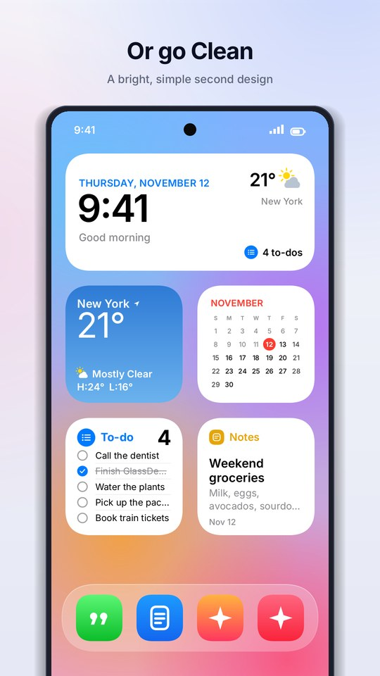

# GlassDesk for Android

Home-screen widgets in GlassDesk's frosted-glass style, plus a settings app to set them up.

<p align="center">
  
  
  
</p>

## Install

1. Download **`GlassDesk-Android-1.7.2.apk`** from the [Releases](../../../releases) page on your phone.
2. Open it and tap **Install**. If Android asks, allow your browser or Files app to install apps.
3. Open **GlassDesk** and tap **Add** under any widget, or touch and hold your home screen and choose **Widgets → GlassDesk**.

Needs Android 8.0 or newer. Coming from a GlassDesk build older than 1.3? Uninstall it first, because newer builds are signed with a different key.

## Widgets

| Widget | What it shows | Tap it to |
|---|---|---|
| Clock | Live time, date, greeting, today's weather and to-dos | Open your alarms |
| System | Battery, memory and storage rings | Refresh |
| Calendar | This month with today highlighted | Open your calendar app |
| Notes | Your note (first line is the title) | Edit it in GlassDesk |
| To-do | Up to 5 tasks | Tick a task off |
| Weather | Now and the next 3 days, from [Open-Meteo](https://open-meteo.com) | Refresh |
| Quote | A new quote every day | Get another quote |
| Countdown | Days until your date | Change the date |
| Fence 1–3 | Up to 8 apps each, like an app folder you can always see | Open an app |

All widgets can be resized. They redraw to fit and refresh about every 15 minutes.

## Two designs

Pick one in **Appearance**:

- **GlassDesk** (default): frosted navy glass tinted with your accent color, a soft glow and a bright rim, like GlassDesk on the desktop. Glass, Dark or Light, with 7 accent colors and a glass tint slider.
- **Clean:** bright, flat and rounded. Automatic (follows dark mode), Light or Dark, with 8 colors.

The app itself follows the design you pick.

## Privacy

GlassDesk has no account, ads or tracking. Its only internet use is the weather: the city you type is sent to Open-Meteo to look it up, then its coordinates are used to get the forecast.

## Build from source

The app is plain Java with no Gradle and no Android Studio needed. It builds with Ubuntu's own Android tools:

```sh
sudo apt install default-jdk aapt dalvik-exchange apksigner zipalign
mkdir -p sdk && cp /path/to/android.jar sdk/   # android.jar for API 33 (from the Android SDK: platforms/android-33)
./build.sh                                      # build/GlassDesk-Android-1.7.2.apk
```

`build.sh` also renders the widget-picker previews and the app icon (on the desktop JVM, with the same drawing code the widgets use). If `keystore/glassdesk.jks` is missing, it creates a new signing key. Official releases are signed with a private key that is not in this repository, so your own build installs as a separate signature.

### Layout

```
src/app/freedev/glassdesk/
  Draw.java          every widget's drawing, for both designs (plain Java)
  Style.java         the two designs: themes, colors and accents
  Sym.java           line icons (weather, battery, folders...)
  G.java, Sq.java    a tiny drawing interface and the rounded "squircle" shape
  AndroidG.java      G on an Android Canvas
  W.java             the widget providers, taps and refresh timer
  P.java, Wx.java    saved settings, content and the weather download
  MainActivity.java  the settings app
  Ui.java            icon drawables for the app
desktop/             Java2D versions used to render previews, store screenshots and the launch video
res/                 widget layouts, widget definitions, previews and the icon
assets/              Inter font files (SIL Open Font License, see FONTS-LICENSE.md)
```
